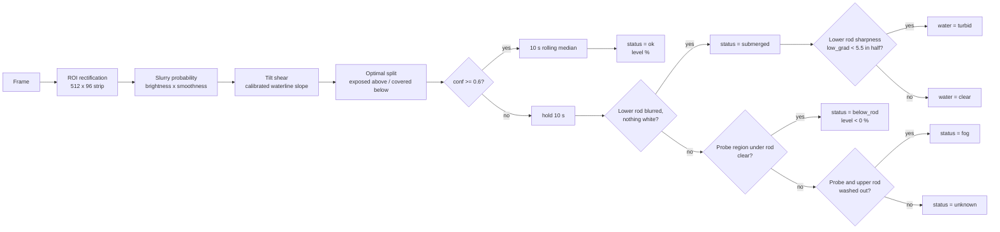

# Agitator Rod Liquid Level

> Fixed-camera liquid-level estimation from how far an agitator shaft is covered by white slurry  
> **Status: PoC — offline evaluation on recorded video from one camera. Not production-deployed.**

化学プラントの混合タンクを上方から撮影した固定カメラ映像から、**撹拌軸（撹拌棒）が白いスラリーにどこまで覆われているか**を求め、液面位置を出力するツールです。

学習済みモデル・GPU・空タンクの基準動画を使わず、**OpenCV と NumPy だけ**で動く単体ツールとして設計しました。
出力は撹拌軸上に設定した ROI の長さに対する百分率（ROI 上端 = 100%、下端 = 0%）で、物理的な高さ（mm・L）ではありません。

## Project status

| Item | Status |
|---|---|
| Development stage | PoC |
| Production deployment | **Not deployed** |
| Data used | 1 camera, 1 day of recorded video (553 clips, about 2.7 min each) |
| Labelled accuracy evaluation | **Not yet performed** (a labelling / evaluation tool exists) |
| Real-time operation | Not evaluated (offline processing of recorded MP4) |

このページの数値は、録画済み映像をオフライン処理した**実際の出力**です。現場での精度・稼働率を示すものではありません。

## Problem

混合工程では液面の推移を記録したいが、タンク内は次の理由で画像認識が難しい環境です。

- スラリーは白く、照明でほぼ白飛びする。液面そのものに模様がない
- 撹拌軸が回転し、波・飛沫で液面付近が常に乱れる
- 投入時の湯気でレンズが曇り、画面全体が白くなる時間帯がある
- 液面と撹拌軸の交線が、カメラの角度のため画面上で斜めに見える

そこで「液面を直接探す」のではなく、**画面上で位置が固定されている撹拌軸を物差しとして使い、露出部と被覆部の境界を探す**方針にしました。

## Method overview

1. **ROI rectification** — 撹拌軸の上端線・下端線（4 点）を透視変換で 512 × 96 の帯に展開（1 行 ≒ 0.2%）。
2. **Slurry probability** — Lab の明度（L 222→236 で 0→1）と局所標準偏差による平滑さから、画素ごとに被覆らしさを計算。
3. **Tilt shear** — 事前校正した水線の傾きで帯をせん断し、各行が実際の水線 1 本に対応するようにする。
4. **Optimal split** — 「上は露出・下は被覆」と最も矛盾の少ない行を求める。経験的しきい値を使わない。信頼度 = 下側被覆率 − 上側被覆率。
5. **Temporal filter** — 信頼度 0.6 以上のフレームだけで 10 秒移動中央値。
6. **No-level decision** — 撹拌軸上に液面がないとき、原因を次の順に判定する（V1.6.4）。
   - `submerged`：カメラが液中。軸の下半分がぼやけているが、どこも白飛びしていない。さらに軸のシャープさで、液が乳白（`turbid`）か透明（`clear`）かを出す（V1.6.5）
   - `below_rod`：軸のすぐ下の領域が明瞭で、軸が全長露出している。液面は軸より下（空タンクを含む）
   - `fog`：軸の下の領域と軸の上半分がともに白飛び（レンズの曇り）
   - `unknown`：上記のいずれでもない

詳細: [Method](docs/method.md)

## Results (one day, offline)

*V1.6.4 の全日出力（553 クリップ）。濃い線 = クリップごとの中央値、薄い帯 = P10–P90。0% の線の下の点は液面がないときの状態（青 = 液中、橙 = 撹拌軸より下、灰 = 曇り、赤 = 不明）。*

| State | Clips | Time |
|---|---|---|
| level | 184 | 09:10〜17:13（液面 9.5〜47.8%） |
| below_rod | 194 | 00:13〜08:45（空タンク）、09:08 |
| submerged | 169 | 17:16 以降（カメラが液中）。ほか 08:51 の 1 本は誤判定 |
| fog | 5 | 08:53〜09:05（投入時のレンズ曇り） |
| unknown | 1 | 08:48（撹拌開始・曇り始めの過渡期） |

- 各クリップの静止画を目視で確認した状況との一致: **551 / 553**
- 液面ありのクリップの有効フレーム率: 中央値 0.91（P10 0.73）。クリップ内の P90−P10 の幅: 中央値 5.3 ポイント
- 液面の値は V1.6.2 から変わっていません（184 クリップで一致）

液中の乳白 / 透明（V1.6.5、17:08〜18:38 の 34 クリップ）：17:21〜17:42 は乳白、17:42 以降は透明と判定。薬品投入後に薄くなる過程は数値に出ているが、透明への切替は想定より約 54 分早く、激しい撹拌中（17:13〜17:21）には乳白が透明と判定されるフレームがある。

詳細: [Evidence](docs/evidence.md)

## Technology

- Python 3
- OpenCV / NumPy
- Perspective rectification, Lab colour space, local statistics
- Threshold-free optimal split, rolling median with hold-over

## Selected source code

コアの処理を `rod_level_v16.py` と `geometry.py` から抜粋しています（関数の中身は原文のまま。抜粋だけで動作する）。→ [Code examples](code-examples/)

- [ROI rectification](code-examples/roi_rectification.py)
- [Boundary detection](code-examples/boundary_detection.py) — slurry probability, tilt shear, optimal split
- [Tilt calibration](code-examples/tilt_calibration.py)
- [Temporal filter & no-level decision](code-examples/temporal_filter.py)

ツール全体（CLI・注釈動画・一括処理・ラベル付けツール）と、カメラ固有の ROI 設定は公開していません。

## Evidence included

- [Liquid type while submerged, 17:08–18:38 (V1.6.5, 34 clips)](evidence/submerged-water-v1.6.5.csv)
- [Day summary with states and visual check (V1.6.4, 553 clips)](evidence/day-summary-v1.6.4.csv)
- [Day summary (V1.6.2, 553 clips)](evidence/day-summary-v1.6.2.csv)
- [Per-frame output, level visible (V1.6.2)](evidence/frames-level-v1.6.2.csv)
- [Per-frame output, below_rod case (V1.6.3)](evidence/frames-below-rod-v1.6.3.csv)

映像・画像・カメラ設定は顧客現場のものであるため掲載していません。

## Changelog

| Version | Change |
|---|---|
| V1.6.5 | `submerged` のときだけ、液が乳白（`turbid`）か透明（`clear`）かを軸の下半分のシャープさで追加判定し、`water` として出力。主状態は増やしていない。液面と他の状態の出力は変更なし |
| V1.6.4 | 液面がないときの判定を `submerged` → `below_rod` → `fog` → `unknown` の 4 段階に変更。V1.6.3 がカメラ液中の時間帯（夕方以降 168 クリップ）を `below_rod` と誤判定していた問題を修正。`no_surface` は `fog` と `unknown` に分割。液面の出力は変更なし |
| V1.6.3 | `below_rod`（液面が撹拌軸より下）と `no_surface` を追加 |
| V1.6.2 | 液面の % 出力（最適分割・傾き補正・時系列フィルタ） |

詳細: [Engineering evolution](docs/engineering-evolution.md)

## Documents

- [Project summary](PROJECT_SUMMARY.md)
- [Method](docs/method.md)
- [Engineering evolution](docs/engineering-evolution.md)
- [Evidence](docs/evidence.md)
- [Limitations & next steps](docs/limitations.md)

---

**Development period:** 2026  
**Role:** problem framing, computer vision algorithm, calibration procedure, offline evaluation tooling, failure analysis
