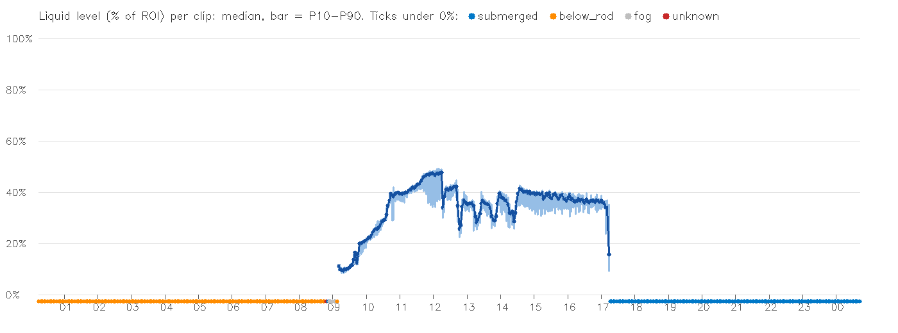
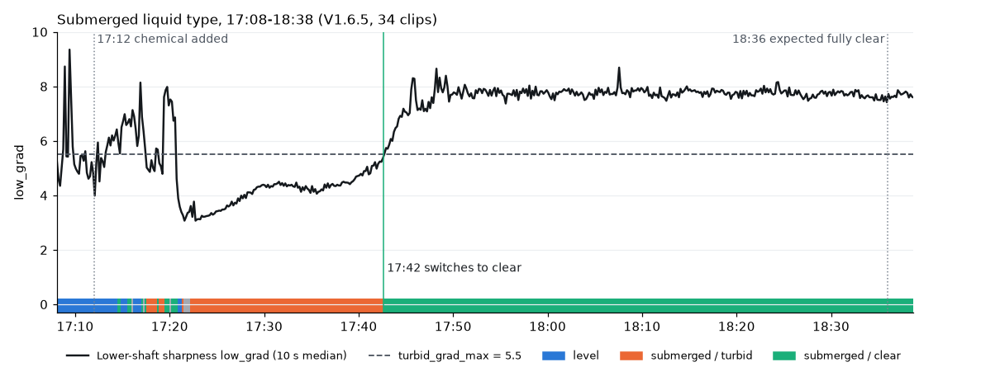

# Evidence

## Important scope note

このページの数値は、**1 台のカメラ・1 日分（2026-10）の録画映像をオフライン処理した実際の出力**です。
ラベル付きの正解との誤差評価はまだ行っていないため、**精度（mm や % の誤差）は示していません**。

映像は顧客現場のものなので、画像・動画は掲載していません。CSV のクリップ名は通し番号に置き換えています。

## 1. One day of clips (V1.6.2)

[`../evidence/day-summary-v1.6.2.csv`](../evidence/day-summary-v1.6.2.csv) — 553 クリップ（1 本約 2.7 分）の集計です。

| Item | Value |
|---|---|
| Clips | 553 |
| Clips with a level | 184（09:10〜17:13） |
| Level range (clip median) | 9.5〜47.8% |
| Valid-frame ratio of clips with a level | median 0.91 / P10 0.73 / min 0.21 |
| P90 − P10 within a clip | median 5.3 / P90 9.5 points |

有効フレーム率が 0.75 未満のクリップは 29 本で、そのうち 27 本は液面が低い 09:10〜10:22（液面 約 9〜26%）に集まっています。残りは 13:17 と、排出中の 17:13 です。液面が下端に近いと被覆部が短く、信頼度が 0.6 に届きにくいためと考えています（未検証）。

## 2. Per-frame examples

| Clip (time) | Version | Frames | Output |
|---|---|---|---|
| 11:42 | V1.6.2 | 668 | `ok` 654 frames, level 43.8〜46.9%, median IQR 2.4 points |
| 10:14 | V1.6.2 | 668 | `ok` 653 frames, level 24.5〜25.6%, median IQR 1.0 point |
| 09:08 | V1.6.3 | 668 | `no_surface` 0〜53 s (lens fog, probe L ≈ 241) → `below_rod` 53〜160 s (probe L ≈ 225)。V1.6.4 では前半が `fog` |
| 19:24, 23:16 | V1.6.2 | 668 each | すべて `no_surface`（V1.6.2 には `below_rod` がない）。V1.6.4 では `submerged` |

- [`../evidence/frames-level-v1.6.2.csv`](../evidence/frames-level-v1.6.2.csv) — 11:42 のクリップ。先頭の約 14 フレームは、10 秒窓に有効フレームがたまるまでの立ち上がり
- [`../evidence/frames-below-rod-v1.6.3.csv`](../evidence/frames-below-rod-v1.6.3.csv) — 09:08 のクリップ。`probe_l` 列で曇りから晴れへの変化が分かる

## 3. States when there is no level (V1.6.4)

[`../evidence/day-summary-v1.6.4.csv`](../evidence/day-summary-v1.6.4.csv) — 553 クリップの状態と、静止画を目視で確認した状況（`visual_check`）。

| Time | Scene (visual check) | V1.6.2 | V1.6.3 | V1.6.4 | Clips |
|---|---|---|---|---|---|
| 00:13〜08:45 | 空タンク | 出力なし | `below_rod` | `below_rod` | 193 |
| 08:48 | 撹拌開始・曇り始め | 出力なし | `below_rod` | `unknown` | 1 |
| 08:51 | 曇り始め（液中ではない） | 出力なし | `below_rod` | `submerged` **（誤り）** | 1 |
| 08:53〜09:05 | 投入時のレンズ曇り | 出力なし | `no_surface` | `fog` | 5 |
| 09:08 | 曇りが晴れた後、タンク底にスラリー（軸には未到達） | 出力なし | `below_rod` | `below_rod` | 1 |
| 09:10〜17:13 | 液面あり | 液面 | 液面 | 液面（値は同じ） | 184 |
| 17:16 以降 | カメラが液中 | 出力なし | `below_rod` **（誤り）** | `submerged` | 168 |

- V1.6.4 と目視の一致: **551 / 553**（誤り 1、判断困難 1）
- V1.6.3 は 17:16 以降を「排出後で軸が露出」と扱っていたが、静止画の確認で液中と分かった（[Engineering evolution §5](engineering-evolution.md#5-v164--below_rod-was-wrong-for-the-whole-evening)）
- `visual_check` はクリップの静止画を見て付けたもので、フレーム単位のラベルではありません

## 4. Liquid type while submerged (V1.6.5)

[`../evidence/submerged-water-v1.6.5.csv`](../evidence/submerged-water-v1.6.5.csv) — 17:08〜18:38 の 34 クリップ。薬品の投入（17:12）後に乳白から透明へ変わり、18:36 に完全に透明になる、という想定で確認しました。

| Time | Output | low_grad (clip median) | Visual check | Assessment |
|---|---|---|---|---|
| 17:08〜17:13 | level（約 34%） | 5.2〜5.4 | 液面あり | OK |
| 17:13〜17:21 | `submerged`、`turbid` と `clear` が入れ替わる | 5.7〜6.3 | 乳白（激しい撹拌・しぶき） | **一部誤り**（1 クリップで 46% のフレームが `clear`） |
| 17:21〜17:42 | `submerged` / `turbid` | 3.2 → 5.0 | 乳白、少しずつ薄くなる | OK |
| 17:42〜18:38 | `submerged` / `clear` | 6.4 → 7.6〜7.9（17:48 以降ほぼ一定） | 透明 | 切替は想定より約 54 分早い |

- 17:42 以降、翌日 00:44 までのクリップ（夜間の静止した透明な液を含む）でも、窓単位で `turbid` になることはなかった（V1.6.4 の 1 日分の出力からの試算）
- `visual_check` はクリップの静止画を見て付けたもの。17:50〜18:36 の間に目で見て分かる変化があるかは未確認
- 液面の値と、他の状態の判定は V1.6.4 から変わっていない

## 5. What is not shown

- ラベル付きの誤差（MAE など）— 評価ツールはあるが未実施
- 複数カメラ・複数日での再現性
- リアルタイム処理での性能
