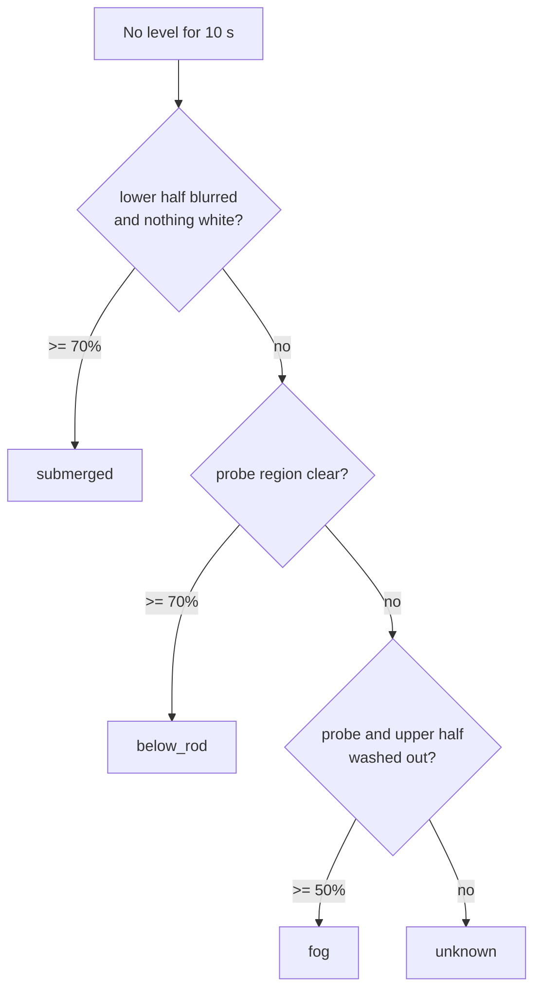

# Method

## 1. Assumptions

- カメラと撹拌軸は画面上で固定（軸の回転は可）
- 液面下の撹拌軸は、ほぼ白飛びした平滑な白（Lab L ≥ 約 222）に見える
- 露出した撹拌軸は暗く、表面にテクスチャがある
- 測れるのは、液面が撹拌軸の見えている範囲（ROI）と交わるときだけ

## 2. ROI rectification

ROI は撹拌軸の **上端線（100%）と下端線（0%）**をそれぞれ 2 点で指定します。この 4 点を透視変換で **512 行 × 96 列**の帯に展開します。

- 行 0 = 上端（100%）、行 511 = 下端（0%）
- 1 行は ROI 長の約 0.2%

→ [`roi_rectification.py`](../code-examples/roi_rectification.py)

## 3. Slurry probability

画素ごとに「スラリーに覆われている確率」を次の積で求めます。

```text
bright = clip((L - 222) / (236 - 222), 0, 1)          # Lab lightness
flat   = clip((12 - local_std_7x7) / 8, 0, 1)          # smoothness
prob   = bright * max(flat, 0.4)
```

- 明るくても模様があれば 0.4 倍に抑える（明るい金属反射・泡の対策）
- カップリングの白い突起は明度が足りず、スラリーとは判定されない

## 4. Tilt shear

液面は水平でも、このカメラ配置では液面と撹拌軸の交線が帯の横方向に対して傾いて見えます。
帯の各行を `row + slope * (col - center)` で読み直し、**出力の 1 行 = 実際の水線 1 本**になるようにします。

傾き `slope` は、液面がはっきり見えるフレームで帯を幅方向に 8 本へ分け、それぞれの境界行に直線を当てはめた傾きの中央値として**一度だけ校正**します（本カメラでは 0.364 行/列）。

→ [`tilt_calibration.py`](../code-examples/tilt_calibration.py)

## 5. Optimal split (threshold-free)

行ごとに確率を平均した系列 `s[0..n-1]` に対し、分割行 `k` のコストを

```text
cost(k) = sum(s[0:k])              # covered-looking rows above the line
        + sum(1 - s[k:n])          # exposed-looking rows below the line
```

とし、最小になる `k` を境界とします。経験的なしきい値はありません。

```text
level      = 100 * (1 - k / 512)
confidence = mean(s[k:]) - mean(s[:k])
```

撹拌軸に何も覆われていないと最適解は `k = 512`（level 0%）になり、信頼度は負になります。

→ [`boundary_detection.py`](../code-examples/boundary_detection.py)

## 6. Temporal filter

- 信頼度 ≥ 0.6 のフレームだけを 10 秒窓に入れる。曇りや照明反射による誤検出の信頼度は約 0.41〜0.45 で、ここで除かれる
- 有効フレームが窓の 30% 以上なら、その中央値を出力（`ok`）。窓内の IQR も出す
- 途切れたら直前の値を最大 10 秒保持（`hold`）

## 7. When there is no level: submerged / below_rod / fog / unknown

撹拌軸上に液面がないとき、その原因を次の 3 つの領域の見え方から判定します。

- 帯の**上半分**（100%→50%）と**下半分**（50%→0%）
- **probe region**：ROI の下半分を、画面の下方向へ軸の幅の約 1.1 倍ずらした四角形（撹拌軸のすぐ下）

フレームごとに条件を判定し、10 秒窓の中で条件を満たすフレームの割合が基準以上なら、その状態とします。上から順に判定します（V1.6.4）。

| Order | Status | Per-frame condition | Share of window |
|---|---|---|---|
| 1 | `submerged` | 下半分がぼやけている（明度の平均勾配 < 9.5。乾いた軸は 10〜12）かつ 下半分が白くない（L < 225）かつ probe region が白くない（L < 230） | ≥ 70% |
| 2 | `below_rod` | probe region の L < 235（視界が明瞭）かつ 1 に該当しない | ≥ 70% |
| 3 | `fog` | probe region の L ≥ 235 かつ 上半分も白い（L ≥ 158。液面より上の露出した軸は L 約 120〜150） | ≥ 50% |
| 4 | `unknown` | いずれにも該当しない | — |

考え方：

- **液中と空タンク**は、どちらも probe region が暗く、軸に白いスラリーが見えない。違いは**軸の下半分のシャープさ**（乾いていれば金具の輪郭がはっきり見え、液中ではぼやける）。
- **曇りと白いスラリー**は、どちらも probe region が白い。違いは**軸の上半分**（曇りなら上半分も白飛びし、スラリーなら露出した軸が暗く見える）。



→ [`temporal_filter.py`](../code-examples/temporal_filter.py)

## 8. Outputs

- 注釈付き動画（ROI、単フレームの境界、フィルタ後の水線、probe region）
- `level.csv`: 1 フレーム 1 行（`raw_level`, `frame_conf`, `level`, `status`, `iqr`, `probe_l`, `low_l`, `low_grad`, `top_l`）
- `summary.json`: クリップの中央値・P10・P90・状態・各状態の割合
- 一括処理時: `day_summary.csv` と日次グラフ
